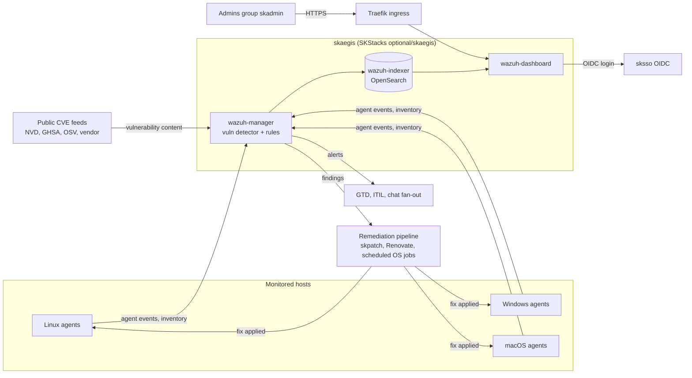
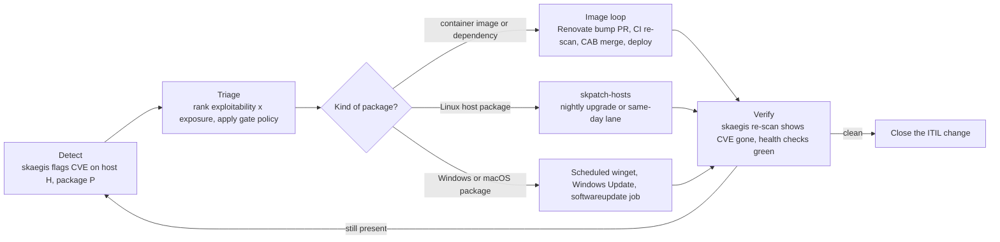

# skaegis 🛡️

**skaegis is a sovereign, self-hosted, cross-OS CVE-detection and closed-loop remediation service: it finds known vulnerabilities on every Linux, Windows and macOS host you run and hands each finding to your existing patch pipeline.** It is a detection plus remediation-orchestration service built on unmodified upstream [Wazuh](https://wazuh.com/); it is not a new scanner engine and not a SaaS.

**Status:** active (design and scaffold phase, nothing deployed from this repo) · **Maturity tier:** T0 - N/A, no key material of its own (per [CRYPTOGRAPHY_STANDARD](https://github.com/smilinTux/sk-standards/blob/main/standards/CRYPTOGRAPHY_STANDARD.md)) · **Version phase:** Incubating v3 (see [SOP section 9](./SOP.md#9-maturity-tier--version-reference)) · **Version:** 0.1.0
**Canonical-home:** https://github.com/smilinTux/skaegis

## The suite: Defend, Detect, Remediate

| Product | Verb | What it does |
|---|---|---|
| **sksec** | Defend | Runtime defense (CrowdSec, NIDS), the closed-loop policy and gate. |
| **skaegis** (this repo) | Detect | Continuous CVE and posture detection across Linux, Windows, macOS. |
| **skpatch** | Remediate | Applies the fix: host packages, image and dependency bumps. |

Three words, one story: defend, detect, remediate. skaegis is the DETECT organ for hosts. Image scanning (CI scan plus SBOM) is the DETECT organ for container images. Same loop, two sensory inputs.

## Where the code lives

This repo is the product's documentation and spec home. The deployable Ansible role lives in the SKStacks framework as `optional/skaegis` (Docker Swarm stack, Traefik route, sksso OIDC, per-instance vault). Nothing renders unless an instance runs its `deploy_skaegis-<env>.yml` play.

## System context

## The closed loop

Detail: [docs/closed-loop.md](./docs/closed-loop.md). The agent drafts, it never auto-merges.

## Tiers (product sketch)

| Tier | Adds |
|---|---|
| **Watch** | Detection plus dashboard. |
| **Guard** | Closed-loop auto-PR remediation. |
| **Fortress** | Runtime threat detection, active response, CIS compliance reporting, audit export. |

These are a product sketch from [docs/design.md](./docs/design.md), not shipped features.

## Honest claims (read this)

- skaegis is a **detection and remediation-orchestration service built on upstream Wazuh**. Detection quality is Wazuh's vulnerability detector matched against public feeds. We do not write scanner logic.
- Detection reports **known, published** CVEs against installed software. It does not find zero-days, and a clean dashboard is not proof of a secure host.
- The remediation half depends on the pipelines you already run. skaegis hands findings over; it does not patch by itself.
- **No crypto of our own.** The role holds no key material beyond ordinary service secrets (OIDC client secret, indexer credentials) kept in the per-instance vault, so the maturity tier is T0 - N/A. Transport security is whatever upstream Wazuh and Traefik provide.
- Nothing here is deployed by merging this repo. The scaffold is docs and spec; the deploy role is tracked in SKStacks.

## Docs

- [SOP.md](./SOP.md) - architecture (mermaid), deploy, operate, troubleshooting.
- [docs/design.md](./docs/design.md) - the product design and build plan.
- [docs/closed-loop.md](./docs/closed-loop.md) - how a CVE actually gets closed.
- [AGENTS.md](./AGENTS.md) - operating brief for agents changing this repo.
- [SECURITY.md](./SECURITY.md) · [CONTRIBUTING.md](./CONTRIBUTING.md) · [CODE_OF_CONDUCT.md](./CODE_OF_CONDUCT.md) · [CHANGELOG.md](./CHANGELOG.md)

## Related projects / See also

- ⬆️ **Depends on:** [Wazuh](https://github.com/wazuh/wazuh) - upstream manager, indexer, dashboard and agents, run unmodified and pinned by digest.
- ⬆️ **Depends on:** [SKStacks](https://github.com/smilinTux/SKStacks) - hosts the `optional/skaegis` deploy role (Swarm, Traefik, vault, sksso OIDC).
- ↔️ **Sibling:** [skpatch](https://github.com/smilinTux/skpatch) - the Remediate half of the suite; applies the fixes skaegis finds.
- ↔️ **Sibling:** [sksec](https://github.com/smilinTux/sksec) - the Defend half and home of the closed-loop policy.
- 📐 **Standards:** [sk-standards](https://github.com/smilinTux/sk-standards) - doc, agent-instruction and architecture standards this repo follows.

## License

GPLv3, see [LICENSE](./LICENSE). The deploy role runs **unmodified upstream Wazuh**, which is itself GPLv3; this repo is licensed to match so there is no license mismatch between the docs/spec home and what it deploys. This is a recorded exception to the Apache-2.0 default in the doc standard.
