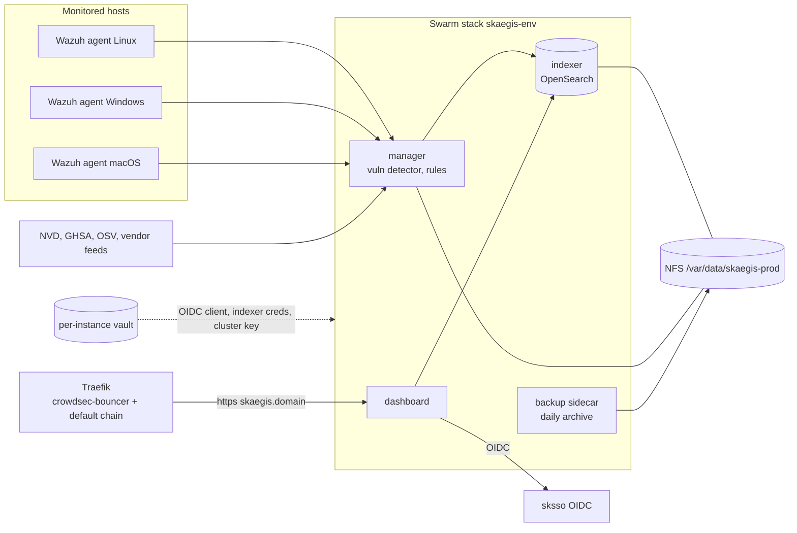
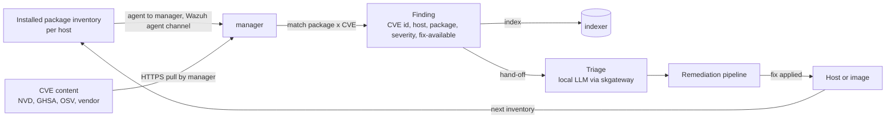
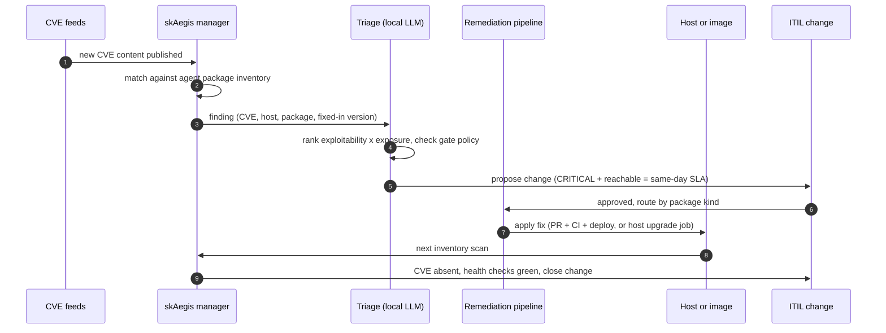

# skaegis - Standard Operating Procedures

skAegis is a sovereign, self-hosted CVE-detection and closed-loop remediation service built on unmodified upstream Wazuh (GPLv2). It is deployed by the SKStacks `optional/skaegis` role and is called by admins through the Wazuh dashboard behind sksso OIDC, and by the remediation pipeline through finding hand-off. This repo is its documentation and spec home.

**Status:** active (scaffold) · **Maturity-tier:** T0 - N/A · **Version:** 0.1.0 · **Canonical-home:** https://github.com/smilinTux/skaegis

## 1. Overview

**Purpose.** Detect known CVEs and misconfigurations on every Linux, Windows and macOS host, rank them, and hand them to the remediation pipeline, then confirm the fix by re-scanning.

**Owns.**
- The product definition, positioning and tier sketch (`docs/design.md`).
- The closed-loop wiring contract (`docs/closed-loop.md`).
- The operating procedures for the `optional/skaegis` deploy role (this file).

**Does NOT do.**
- It does not ship a scanner. Detection is upstream Wazuh's vulnerability detector.
- It does not contain the Ansible role. That lives in SKStacks `optional/skaegis`.
- It does not apply patches. skpatch, Renovate and scheduled OS jobs do.
- It does not find zero-days, and it holds no key material of its own.

## 2. Architecture

Three Swarm services, all unmodified upstream Wazuh images pinned by `@sha256:` digest (the play refuses an unpinned image).

| Service | Image | Replicas | Role |
|---|---|---|---|
| `indexer` | `wazuh/wazuh-indexer` | 1 (data node) | OpenSearch-based store for events, alerts and CVE state. The RAM-hungry one. |
| `manager` | `wazuh/wazuh-manager` | 1 | Ingests agent data, runs the vulnerability detector and rules, holds the CVE register. |
| `dashboard` | `wazuh/wazuh-dashboard` | 1 | The web UI, behind sksso OIDC. |

Networks: `skaegis-<env>` (internal, all three services) and `cloud-public-<env>` (dashboard only). Data: NFS under `/var/data/skaegis-prod/{indexer,manager,backup}` (root, mode 0700) with a daily archive sidecar that keeps N days.



### Data flow



| Data | Where it lives | Protection |
|---|---|---|
| Package inventory, findings | indexer data dir on NFS | Upstream Wazuh transport and auth; filesystem mode 0700. |
| OIDC client secret, indexer creds, cluster key | per-instance vault | Never hardcoded in compose or MCP config. |
| Admin sessions | sksso | OIDC, admin via `skadmin` group. |

### Sequence: one CVE, detection to closure



**Start here:**
1. `README.md`: the suite framing and the two mermaid views.
2. `docs/design.md`: the product design, tiers and build plan.
3. `docs/closed-loop.md`: how a finding becomes a closed change.
4. `SOP.md` (this file): operate and troubleshoot.
5. `AGENTS.md`: rules for an agent changing this repo.

## 3. Build

N/A - this repo contains documentation and spec only, with no build artifact. The deployable artifact is the SKStacks `optional/skaegis` role, built and linted in that repo. Images are upstream, unmodified, and pinned by digest in the role defaults.

## 4. Test

The gate for this repo is the sk-standards docs gate plus a dash check:

```bash
python3 /path/to/sk-standards/scripts/docs_check.py --repo .
! grep -rnP '\x{2014}|\x{2013}' --include='*.md' . 
```

Deploy-side tests (role lint, `--syntax-check`, the unpinned-image refusal) live in the SKStacks repo and block a role release there.

## 5. Release / Deploy

Deploy is a SKStacks operation, not a build from this repo. Opt-in: nothing renders unless an instance runs `deploy_skaegis-<env>.yml`.

```bash
# from the SKStacks checkout (names illustrative, check the role README for the exact play)
ansible-playbook deploy_skaegis-prod.yml --syntax-check
ansible-playbook deploy_skaegis-prod.yml
```

Order of a first rollout:
1. Create the per-instance vault `skaegis-prod-<domain>_vault.yml` (OIDC client id and secret, indexer creds, cluster key). Capture the break-glass admin off-cluster.
2. Pin all three images by `@sha256:` digest in the role defaults.
3. Deploy the stack, confirm `indexer` is healthy before `manager`, then `dashboard`.
4. Register the dashboard as an OIDC client in sksso and add the portal tile.
5. Enrol agents (Linux via Ansible, Windows via the existing remote-management agent rail, macOS via pkg) and enable the vulnerability detector.

**Rollback:** redeploy the previous pinned digests. Indexer and manager data persist on NFS; restore from the daily archive in `/var/data/skaegis-prod/backup` if a data dir is damaged.

**Docs releases:** bump `CHANGELOG.md`, tag `vMAJOR.MINOR.PATCH`.

**Front-end / Exposure:**
- **Tier:** `2 SKStacks/Traefik`
- **Public `:443` route(s):** `https://skaegis.<domain>/` (the Wazuh dashboard only), behind the crowdsec-bouncer and default-chain middlewares, authenticated by sksso OIDC.
- **Bind address:** the dashboard joins `cloud-public-<env>` and is reached only through Traefik. Indexer and manager publish no host ports for the public network; agent enrolment reaches the manager over the internal or tailnet path, never a public port. (Verify the exact agent-port exposure against the deployed role before relying on this line.)

## 6. Configuration / Usage

| Item | Where | Notes |
|---|---|---|
| Image digests | role defaults (`@sha256:`) | Unpinned image is refused by the play. |
| Secrets | `skaegis-prod-<domain>_vault.yml` | Never inline a live secret in compose, docs or MCP config. |
| Admin access | sksso group `skadmin` | Dashboard OIDC client. |
| Data root | `/var/data/skaegis-prod/{indexer,manager,backup}` | Root, mode 0700. |
| Sizing | indexer RAM floor roughly 2 to 4 GB | Place on a host with real headroom, see `docs/design.md` open decisions. |
| Triage inference | skgateway `http://localhost:18780/v1`, model `sk-default` | Do not hardcode a model. |

Usage: sign in at the dashboard through sksso, open the vulnerability view per agent, and follow findings through the ITIL change that the loop opens.

## 7. API / Reference

This repo exposes no API. Operators use the upstream Wazuh dashboard and the upstream Wazuh API (manager). Finding hand-off to the pipeline is specified in [docs/closed-loop.md](./docs/closed-loop.md): each finding carries `CVE id, host, package, severity, fix-available`.

## 8. Troubleshooting

| Symptom | Check |
|---|---|
| Dashboard unreachable | Traefik route for `skaegis.<domain>`, `cloud-public-<env>` attachment, then `docker service ps` for the dashboard. |
| Login loop or 401 at the dashboard | OIDC client id/secret in the vault match sksso, redirect URI is the dashboard host, user is in `skadmin`. |
| Indexer service flapping or OOM-killed | Host RAM headroom (floor roughly 2 to 4 GB), JVM heap setting, other tenants on the node. |
| No CVE findings for a host | Agent enrolled and active, vulnerability detector enabled, manager has pulled feed content, OS and package inventory present. |
| Agent will not enrol | Manager enrolment path reachable from the host, agent version compatible with the manager, cluster key correct. |
| Play refuses to deploy | An image reference is not pinned by `@sha256:`. Pin it. |
| CVE still shown after patch | Host has not re-reported inventory yet, or the fix landed in a different package or reboot is pending. |

## 9. Maturity-tier + Version reference

- **Maturity-tier:** T0 - N/A. skAegis holds no key material of its own. It is not a crypto component, so no CRYPTOGRAPHY_STANDARD suite claim is made. Transport and auth are upstream Wazuh, Traefik and sksso.
- **Version phase:** Incubating v3 (per [VERSION_LIFECYCLE](https://github.com/smilinTux/sk-standards/blob/main/standards/VERSION_LIFECYCLE.md)).
- **SemVer:** 0.1.0 (scaffold). See [CHANGELOG.md](./CHANGELOG.md).
- **License:** GPL-2.0-only, matching upstream Wazuh.

<!-- docs-evidence
     Executed by the docs-check gate (DOCS_FRESHNESS_STANDARD 1.3).
     Hermetic, repo-local checks only.
verified: 2026-11-11
checks:
  - name: canonical home stated in README
    run: grep -q 'https://github.com/smilinTux/skaegis' README.md
  - name: tier stated in README
    run: grep -q 'T0 - N/A' README.md
  - name: three services documented
    run: grep -q 'wazuh-indexer' SOP.md && grep -q 'wazuh-manager' SOP.md && grep -q 'wazuh-dashboard' SOP.md
  - name: closed-loop doc present
    run: test -f docs/closed-loop.md && test -f docs/design.md
  - name: license is GPLv2
    run: grep -q 'GNU GENERAL PUBLIC LICENSE' LICENSE && grep -q 'Version 2' LICENSE
-->
