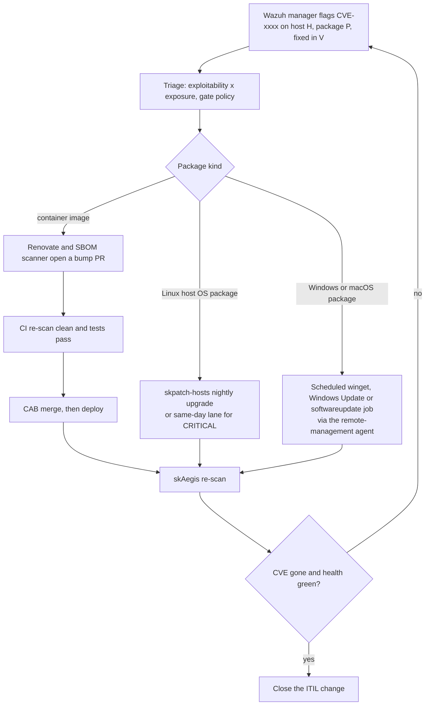
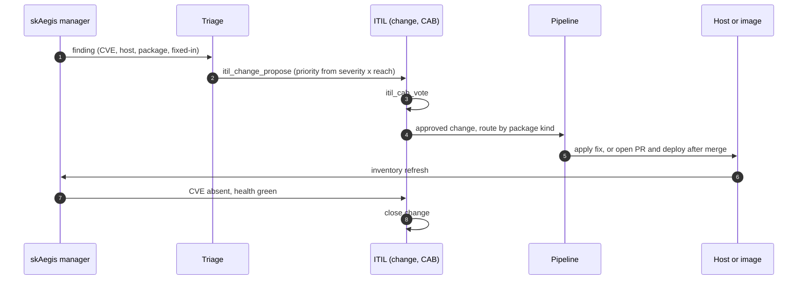

# skAegis closed-loop wiring

How a CVE actually gets closed. Companion to [design.md](./design.md) and [SOP.md](../SOP.md). The loop is the same shape as the sksec closed-loop; skAegis supplies the host-side DETECT input.

## Stages

| Stage | Owner | Input | Output |
|---|---|---|---|
| Detect | skAegis manager (Wazuh vulnerability detector) | Host package inventory plus public CVE feeds (NVD, GHSA, OSV, vendor) | Finding: `CVE id, host, package, severity, fix-available` |
| Triage | Local LLM through skgateway (`http://localhost:18780/v1`, model `sk-default`) | Finding plus exposure context | Ranked finding, gate-policy decision |
| Route | Loop policy | Ranked finding, package kind | Image loop, Linux host lane, or Windows/macOS job |
| Remediate | skpatch, Renovate, scheduled OS update jobs | Routed finding | A fix applied or a PR opened |
| Verify | skAegis re-scan plus health monitoring | Next inventory scan | CVE absent and services healthy, or back to Detect |
| Close | ITIL change | Verify result | Change closed |

## Flow

## Sequence

## Policy

- **CRITICAL and reachable:** same-day SLA through `itil_change_propose` and `itil_cab_vote`.
- **Everything else:** batched into the nightly or scheduled lane.
- **Guardrail:** the agent drafts, it never auto-merges. A human or the CAB gate approves.
- **Fix not available:** the finding stays open with a `no-fix` marker; mitigation or acceptance is recorded in the change, not silently dropped.

## Hand-off contract

Every finding passed to Triage and the pipeline MUST carry: CVE id, host identifier, package name and installed version, severity, and fix-available (with fixed-in version when known). Each finding is upserted by `(source, source_ref)` so re-detection updates rather than duplicates it.

## Honest limits

- Detection covers **known, published** CVEs against software the agent can inventory.
- Verify depends on the host re-reporting inventory; there is a lag between a patch and a clean re-scan.
- Windows and macOS auto-apply is a later phase; until then those remediations are manual or scheduled by hand.
