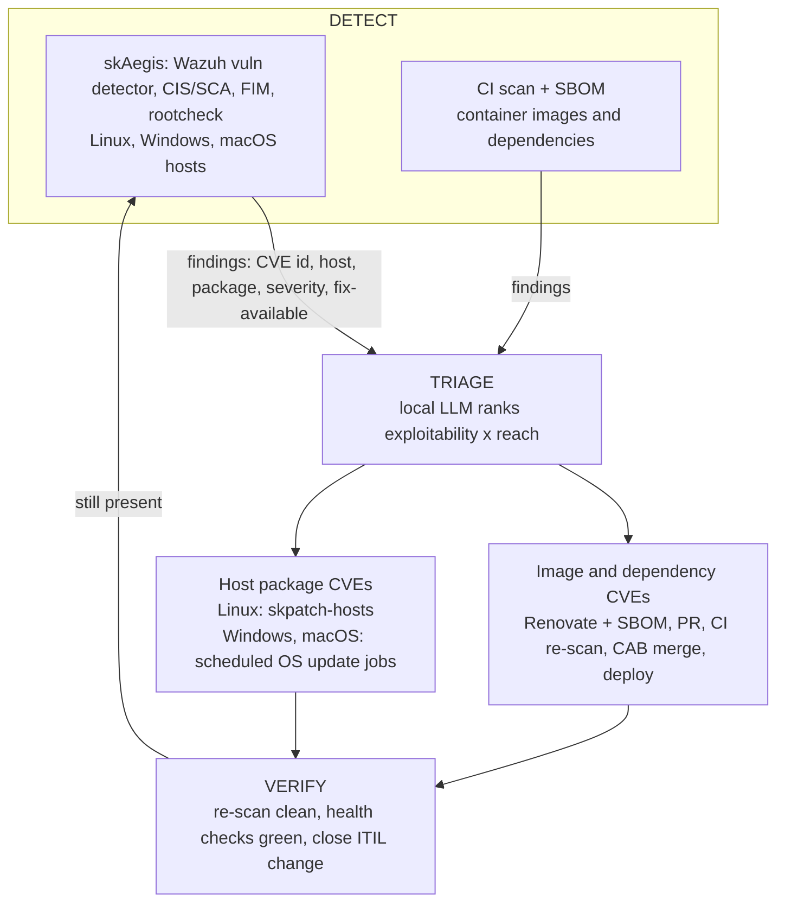

# skAegis design

**Status:** active, scaffold phase. Nothing is deployed from this repo. The deploy role is tracked in SKStacks as `optional/skaegis`. This is the cleaned-up Phase 1 design, the source of truth for product content. See [README.md](../README.md) and [SOP.md](../SOP.md).

## 0. Summary

A fleet already running a GitOps remediation loop (image and dependency bumps through Renovate and an SBOM scanner, Linux host upgrades through skpatch-hosts) is missing one organ: fleet-wide, cross-OS vulnerability **detection**, the radar that sees every CVE the moment it lands on every host regardless of OS. That is Wazuh, which the architecture already names in its DETECT layer.

skAegis is the product wrapper around it: a self-hosted, SSO'd, portal-tiled service that detects CVEs and misconfigurations on Linux, Windows and macOS hosts and feeds findings into the remediation loop that already exists (Renovate plus SBOM for images, skpatch-hosts for Linux packages, scheduled jobs for Windows and macOS).

Not adopted: FleetDM and Tactical RMM. They are endpoint-management agent models orthogonal to a GitOps loop, and Tactical largely re-wraps the remote-management agent already in place. FleetDM remains a Phase 4, only-if option for formal Apple and Windows MDM enforcement.

## 1. Name

| Name | Reads as | Suite fit | Note |
|---|---|---|---|
| **skAegis** (chosen) | Shield, protection incarnate | sksec, skpatch, skAegis | Premium tone, no vulnerability-management product collision. |
| skArgus | The all-seeing | Detection-forward identity | Considered, emphasises visibility. |
| skBastion | Fortified strongpoint | Fortress feel | Considered, more infrastructure-sounding. |

Tagline: *"Your continuous shield: every CVE seen, every gap closed."*

## 2. What it is

> skAegis is continuous vulnerability intelligence for your whole fleet. It watches every machine you run (Linux servers, Windows laptops, Macs) and, when a new CVE is published against something you have installed, it tells you, ranks it by exploitability and exposure, and hands the fix to your patch pipeline. Detection to remediation, closed loop, on your own infrastructure. No cloud SaaS, no data leaving your walls.

Honest scope: it reports **known, published** CVEs and posture gaps. It is a detection and remediation-orchestration service built on upstream Wazuh. It does not find zero-days and does not patch anything itself.

Suite framing: **Defend (sksec), Detect (skAegis), Remediate (skpatch).**

## 3. Where it fits

skAegis is the DETECT organ for **hosts**. The existing CI scan plus SBOM are DETECT for **images**. Same loop, two sensory inputs.

## 4. Architecture (role shape)

Opt-in `optional/skaegis` role. Nothing renders unless an instance runs `deploy_skaegis-<env>.yml`.

**Upstream and license.** Wazuh is GPLv2, fully self-hostable, with official multi-arch images. skAegis runs unmodified upstream images pinned by `@sha256:` (the play refuses an unpinned image).

| Service | Image | Replicas | Role |
|---|---|---|---|
| `indexer` | `wazuh/wazuh-indexer` | 1 (data node) | OpenSearch-based store for events, alerts, CVE state. The RAM-hungry one. |
| `manager` | `wazuh/wazuh-manager` | 1 | Ingests agent data, runs the vulnerability detector and rules, holds the CVE register. |
| `dashboard` | `wazuh/wazuh-dashboard` | 1 | The web UI, behind sksso OIDC. |

Framework-standard integration:
- **SSO:** sksso OIDC, admin via the `skadmin` group (dashboard OIDC client).
- **Ingress:** Traefik route `https://skaegis.<domain>/` with crowdsec-bouncer and default-chain middlewares.
- **Vault:** `skaegis-prod-<domain>_vault.yml` holds OIDC client id and secret, indexer credentials and the cluster key. No DSN or secret is hardcoded in MCP config or compose.
- **Data:** NFS under `/var/data/skaegis-prod/{indexer,manager,backup}` (root, mode 0700), daily archive kept N days by a backup sidecar.
- **Portal tile:** an Authentik application serves as the dashboard tile.
- **Networks:** `skaegis-<env>` (internal) and `cloud-public-<env>` (dashboard only).

**Resourcing (open decision):** the Wazuh indexer wants roughly 2 to 4 GB RAM floor. A small dedicated VM (about 4 vCPU and 6 to 8 GB) or a worker with real headroom is likely, not a node that is already memory-tight.

## 5. Agent delivery

Detection needs an agent per host, delivered over rails already owned:
- **Linux:** Wazuh agent through Ansible, reusing the patch-target host inventory discipline.
- **Windows:** push the Wazuh agent through the existing remote-management (MeshCentral) agent, which becomes the software-delivery rail for Windows. One Windows host with that agent is the first proving ground.
- **macOS:** Wazuh macOS agent (pkg) when Macs come online, same enrolment.

## 6. What it detects

- **Phase 1:** CVE and vulnerability detection (the vulnerability detector matched against NVD, GHSA, OSV and vendor feeds) per host, with fix-available and severity. CIS/SCA posture checks. File-integrity monitoring on key paths.
- **Later tiers:** log-based threat detection, rootcheck, active response, MITRE ATT&CK mapping, and alerts into GTD, ITIL and chat through the existing notification fan-out.

## 7. Closed-loop wiring

See [closed-loop.md](./closed-loop.md). In short: flag, triage, route by package kind, apply, re-scan, close. CRITICAL and reachable gets a same-day SLA through an ITIL change and CAB vote; everything else batches. The agent drafts and never auto-merges.

## 8. Build plan (Phase 1)

1. **Role scaffold** `optional/skaegis` (README, SOP, `deploy_*.yml`, compose source, defaults, vault template), with skrac as the template.
2. **Stand up the stack** (indexer, manager, dashboard), SSO wired, tile up, break-glass admin captured off-cluster.
3. **Enrol first hosts:** the Linux estate via Ansible and one Windows host via the remote-management rail (the Windows proof).
4. **Turn on the vulnerability detector** and confirm CVE findings surface in the dashboard.
5. **Wire notifications** into GTD, ITIL and chat. The detection loop is then live.
6. Image-loop and Windows/macOS auto-apply are Phase 2 and 3, each with its own write-up.

Delivery flow: branch, PR, deploy, with review before anything merges.

## 9. Open decisions

1. **Host and resourcing:** dedicated VM (about 6 to 8 GB) versus a worker with headroom. The indexer is the RAM driver.
2. **Scope of first enrolment:** all Linux servers at once, or servers first and then laptops and Windows.
3. **Marketing depth now:** draft the website and tier copy in this pass or after the tech ships.

(The name decision in section 1 is closed: skAegis.)

## 10. Marketing and white-label notes

- Suite framing: **Defend (sksec), Detect (skAegis), Remediate (skpatch).**
- Hero claim: *"Every CVE, every host, every OS, found when it is published against what you run and closed on your own infrastructure. No SaaS. No data leaves your walls."* Read it as scoped to known, published CVEs.
- Tiers (sketch): **Watch** (detection and dashboard), **Guard** (plus closed-loop auto-PR remediation), **Fortress** (plus runtime threat detection, active response, compliance and CIS reporting, audit export).
- White-label: single-tenant, your domain, your SSO, your branding.
